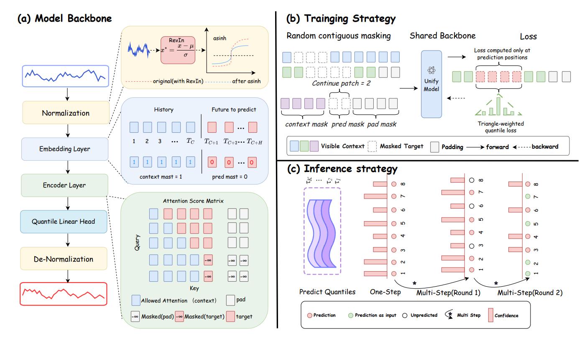

# FlexCast: Flexible Context-Target Learning for Time Series Foundation Models

FlexCast reformulates time series forecasting as variable-length masked prediction over patches. During pretraining, it dynamically samples both visible contexts and prediction targets, exposing the model to diverse forecasting patterns without requiring left-to-right rollout. The same pretrained model supports one-step forecasting, confidence-based multi-step refinement, and next-token-style generation through a unified mask-and-predict interface.

## Setup

```bash
# Python 3.12 + PyTorch 2.5.1 with CUDA 12.4
conda create -n flexcast_env python=3.12 -y
conda activate flexcast_env
pip install -r requirements.txt
```

## Datasets

Download the benchmark datasets and place them under `./dataset/`:

```
dataset/
├── ETT-small/          # ETTh1, ETTh2, ETTm1, ETTm2
│   ├── ETTh1.csv
│   ├── ETTh2.csv
│   ├── ETTm1.csv
│   └── ETTm2.csv
├── weather/
│   └── weather.csv
└── globaltemp/
    └── global_temp_test.jsonl
```

| Dataset | Download |
|---------|----------|
| ETT-small + Weather | [Google Drive](https://drive.google.com/drive/folders/1vE0ONyqPlym2JaaAoEe0XNDR8FS_d322) |
| GlobalTemp (test) | [Google Drive](https://drive.google.com/drive/folders/1KjnAYr9X3D-jyJpo4yM7Giyq5V1Hga_7) |

## Quick Start

```bash
bash run_inference.sh
```

The model checkpoint is hosted on [HuggingFace](https://huggingface.co/zuyangsammie/FlexCast) and automatically downloaded.

## Architecture

```
raw [B,T,C] → RevIN → patchify → ResidualBlock(in)
→ Encoder(pre-norm + RoPE + Flash Attention)
→ ResidualBlock(out) → decode_quantiles → RevIN(inverse) → [B,T,C,Q]
```




- **RevIN with asinh**: reversible instance normalization for non-stationary series
- **Patch embedding** (patch_len=16): converts variable-length sequences to patches
- **RoPE attention**: relative position encoding via Flash Attention
- **Quantile prediction** (99 quantiles): monotonic softplus decoding with Pinball loss

## Core Idea

FlexCast reformulates forecasting as **variable-length masked prediction over time series patches**. It decomposes the autoregressive (AR) paradigm into three decoupled factors—variable-context conditioning, short-target prediction, and sequential rollout—and shows that flexible context-target learning, not sequential decoding, is the primary driver of strong TSFM performance.

## Mask-and-Predict Interface

FlexCast operates with three mutually exclusive patch-level masks:

| Mask | Role |
|------|------|
| `m_ctx` | Context patches: visible to the model, condition the prediction |
| `m_pred` | Prediction patches: masked during pretraining, supervised by loss |
| `m_pad` | Padding patches: excluded from attention, handle variable-length sequences |

This unified interface naturally supports diverse forecasting scenarios: standard forecasting (target at tail), imputation (target in middle), and AR next-patch prediction (single-patch target) are all special cases of the same masking framework.

## Pre-training

FlexCast is pre-trained on the BLAST corpus (~1.9B time points) with **dynamic masking** along multiple axes:

- **Context windows**: variable (128–4096), randomly sampled per batch
- **Mask ratio**: [10%, 30%] of effective sequence length per sample
- **Mask pattern**: random contiguous segment positioned within the effective region
- **Loss**: SumQ Pinball — sum over Q quantiles divided by √Q (99 quantile levels)
- **Norm**: RevIN with asinh transformation

Unlike static masking approaches (e.g., TimesBERT's fixed 25% random mask at context length 512), FlexCast's dynamic masking produces a rich distribution of context-target pairs during pretraining, enabling zero-shot transfer to unseen forecasting tasks without fine-tuning.

## Inference

FlexCast supports multiple generation strategies through the same mask-and-predict interface:

| Strategy | Description |
|----------|-------------|
| **One-shot** | Mask entire horizon, predict all patches in a single forward pass |
| **Confidence-ordered** | Multi-round refinement: quantile interval width as uncertainty, reveal high-confidence patches first (inspired by MaskGIT) |
| **Left-to-right (AR)** | Sequential next-patch prediction, same as mainstream AR TSFMs |

Since all strategies share the same pretrained model, architecture, and objective, their comparison directly isolates the role of sequential rollout.

```bash
bash run_inference.sh
```

## Key Findings

- **Flexible context-target learning** is the primary driver of zero-shot generalization—not sequential rollout
- One-step inference achieves **state-of-the-art or competitive zero-shot accuracy** while substantially reducing latency compared to sequential TSFMs
- Confidence-ordered refinement provides additional gains mainly in **long-horizon or high-uncertainty** settings
- Left-to-right rollout does not provide consistent gains once flexible context-target relationships have been learned, and **can suffer from error accumulation**
